Please review the [license](https://github.com/aykme/Anoti/blob/develop/LICENSE) before using

Anoti - anime info & notifs

Download the app:

<!-- The badge is hidden until the iOS app is live on the App Store.

-->
[App Store](https://apps.apple.com/app/id6827621853)

[Google Play](https://play.google.com/store/apps/details?id=com.alekseivinogradov.anoti)

Stay on top of the anime you follow: Anoti lets you know when the next episode is out and helps you
remember where you left off.

■ Pick anime from the lists of shows airing now and upcoming announcements, or search by title

■ Tap the bell to subscribe and get a notification with the poster and episode number when the
next episode comes out

■ See the release date of the next episode, or when an announced show is expected to begin

■ Keep all your subscriptions in Favorites; a badge on its tab shows how many have fresh episodes

■ Count the episodes you've seen so you don't lose your place

■ Pull down on Favorites to check for fresh episodes right away

■ Your Favorites are available offline

■ Dark design for phones and tablets, with screen reader and larger text support

Phone:

<!-- The images are stored at least twice as wide as shown, so they stay sharp on dense screens. -->
<!--suppress CheckImageSize -->

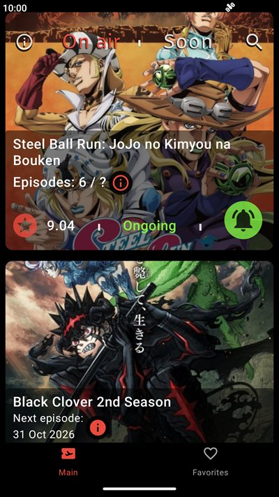
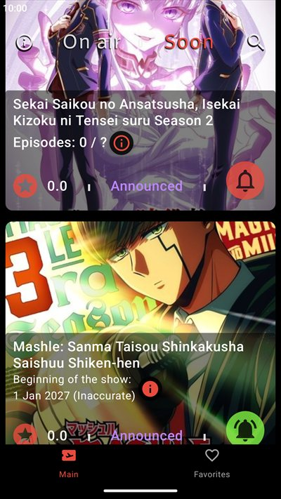
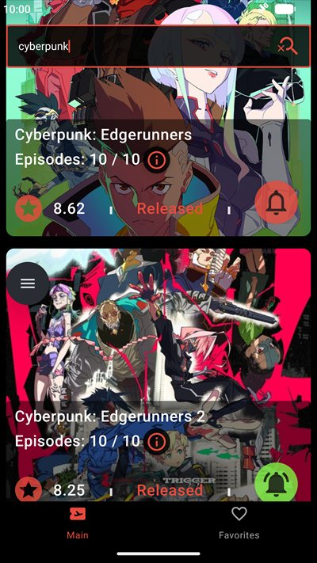
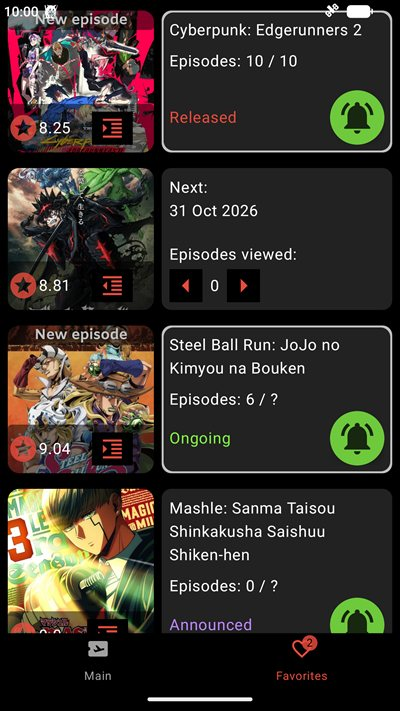
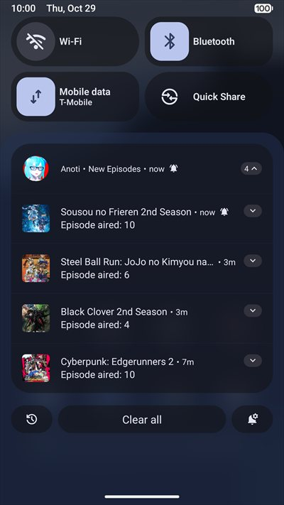
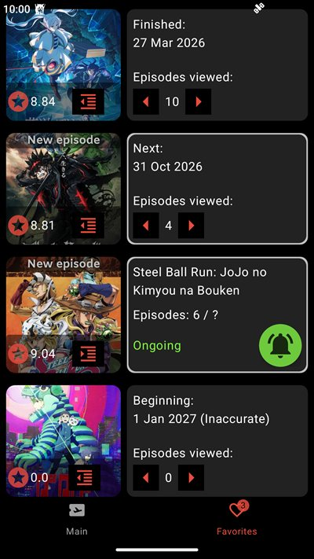

Tablet:

<!--suppress CheckImageSize -->

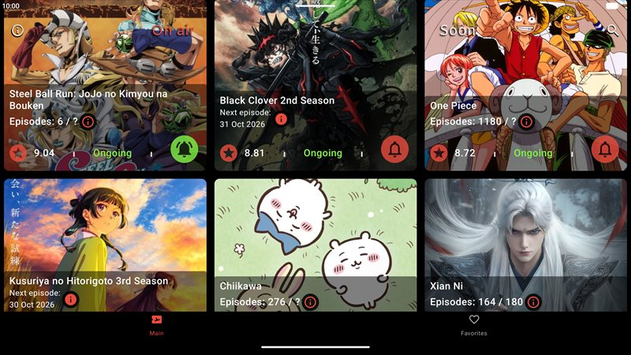
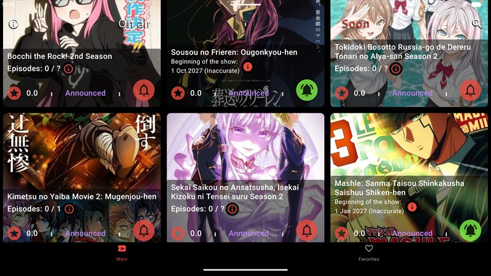

<!--suppress CheckImageSize -->

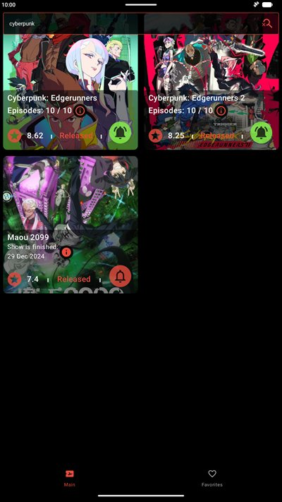
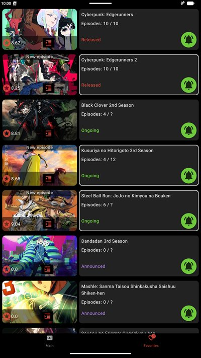
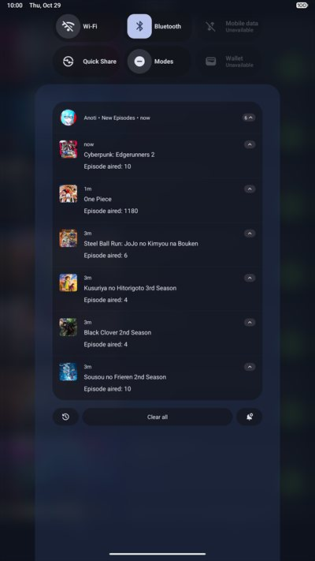
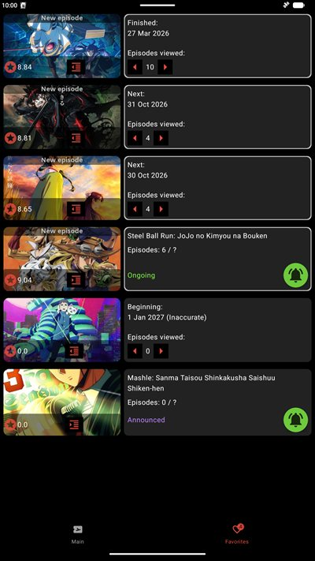

Technology stack:

1. A fully [Kotlin Multiplatform](https://kotlinlang.org/docs/multiplatform.html) app with an
   Android and an iOS project. The business logic, the UI, the data layer and DI are shared by
   both platforms. Platform code is kept to what only the OS can do, such as notifications and
   background updates.
2. The UI is built with [Compose Multiplatform](https://github.com/JetBrains/compose-multiplatform)
   and shared by Android and iOS.
3. Multi-module architecture. MVI is based on [MVIKotlin](https://github.com/arkivanov/MVIKotlin),
   navigation on [Decompose](https://github.com/arkivanov/Decompose).
4. Kotlin Coroutines and Flow.
5. Networking is implemented via [Ktor](https://github.com/ktorio/ktor). Anime data comes from
   the [Shikimori GraphQL API](https://shikimori.io/api/doc/graphql) instead of REST, to cut the
   number of requests: one request returns a whole page with only the fields the app needs, the
   posters and the next-episode dates included.
6. The local database is implemented via
   [Room](https://developer.android.com/kotlin/multiplatform/room) for Kotlin Multiplatform.
7. Custom pagination, written without third-party libraries and designed to fit MVI and UDF.
8. DI is implemented through [kotlin-inject](https://github.com/evant/kotlin-inject).
9. Unit testing is done with
   [kotlin-test](https://github.com/JetBrains/kotlin/tree/master/libraries/kotlin.test). Test
   doubles are handwritten fakes, plus Ktor's `MockEngine` for the network. Line coverage over
   the whole project is held at no less than 95%, measured with
   [Kover](https://github.com/Kotlin/kotlinx-kover) and enforced by a build that fails below it.
10. Static analysis is done with [detekt](https://detekt.dev) for Kotlin and
    [SwiftLint](https://github.com/realm/SwiftLint) for Swift. detekt checks every module and
    source set, the shared KMP code and the Android app alike. It runs with its ktlint-based
    formatting rules and with the [Compose rules](https://github.com/mrmans0n/compose-rules).
    SwiftLint checks the iOS app, its analyzer rules included. Both run on CI.
11. The shipped app is shrunk. On Android, the `release` and `minified` build types run
    [R8](https://developer.android.com/build/shrink-code). It shrinks, optimizes and obfuscates
    the code and removes unused resources. `minified` is `release` signed with the debug key, so
    it installs on a device. On iOS, the Release build strips symbols and dead code from the
    executable and keeps a dSYM to decode crash reports. Kotlin/Native offers no obfuscation.
12. CI runs on [GitHub Actions](https://github.com/features/actions). Every push to `develop`
    builds both apps and runs their checks: on Android the host tests, detekt and the coverage
    bar; on iOS, on a macOS runner, the Kotlin/Native tests on a simulator and SwiftLint. A manual
    iOS run adds the UI tests on iPhone and iPad simulators, in both orientations and at large
    text sizes, and a check of the stripped Release build. The iOS app is uploaded to TestFlight
    from CI too, signed through an App Store Connect API key, so no Mac is needed.

Minimum versions:

1. The app runs on Android 10 (API 29) and newer, and on iOS 16 and newer.
2. The Android app is built with Android Studio Panda 2 (2025.3.2) or newer. It is the oldest
   Android Studio that supports the project's Android Gradle Plugin.
3. Gradle runs on JDK 21. When Gradle finds no JDK 21 on the machine, it downloads one during the
   first Gradle sync.
4. The iOS app is built with Xcode 26.4 or newer, the release the project's Kotlin version is
   documented against. Xcode 26.4 runs on macOS Tahoe 26.2 and newer.
5. The iOS build runs the project's Gradle build as well, so the Mac also needs a JDK. Any JDK
   starts the build, the one inside Android Studio included, and JDK 21 is downloaded like on any
   other machine. The Android SDK is not needed for it.

Setting up the Android project:

1. Install Android Studio Panda 2 (2025.3.2) or newer. Its first-launch wizard downloads the
   Android SDK.
2. Open the repository root in Android Studio and wait for the Gradle sync to finish. No separate
   JDK install is needed. Gradle first looks for an installed JDK 21: the one `JAVA_HOME` points
   to, the usual install folders of the system, and JDKs installed through Android Studio. Only
   when it finds none does it download JDK 21 during that sync.
3. Run the `androidApp` configuration.

Setting up the iOS project:

1. Install Xcode 26.4 or newer.
2. Give the build a Java, in one of two ways:
   - Install Android Studio into the standard `/Applications` folder. The build finds the Java
     inside it there, so no separate JDK is needed.
   - Or install any JDK with its ordinary installer.
3. Open `iosApp/iosApp.xcodeproj` in Xcode, pick an iPhone simulator and run the `iosApp` scheme.
   The first build takes long: it compiles the whole shared code for iOS.
